

  <picture>
    <source media="(max-width: 600px)" srcset="assets/banner-mobile.svg" />
    
  </picture>

  <a href="https://www.linkedin.com/in/enzocipriani/">LinkedIn</a> &nbsp;·&nbsp; <a href="https://e2tcode.com">E2T Code</a> &nbsp;·&nbsp; <a href="https://hubarenas.com">Hub Arenas</a> &nbsp;·&nbsp; <a href="https://arcassistant.com/">Arc Assistant</a>

## About me

I’m a full-stack developer, product-minded designer and technology entrepreneur based in Brazil, currently studying Computer Science at the Federal University of São João del-Rei (UFSJ).

As co-founder of **E2T Code**, **Hub Arenas** and **Arc Assistant**, I build digital products at the intersection of software engineering, design and business — turning ideas into real-world solutions.

---

## My ventures

  <a href="https://hubarenas.com">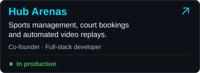</a>
  <a href="https://e2tcode.com">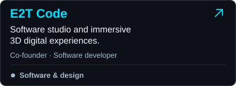</a>
  <a href="https://arcassistant.com/">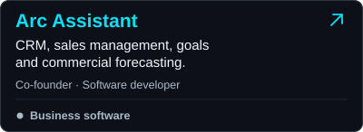</a>

---

## Featured products

  <a href="https://onurbclick.com.br/">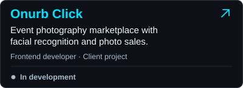</a>
  <a href="https://onurbpass.com.br/">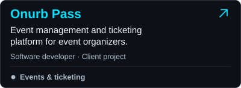</a>
  <a href="https://jobbapp.com/">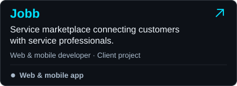</a>
  <a href="https://sennaviannini.com.br/">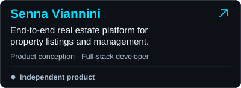</a>

---

## Selected client work

  <a href="https://www.projetoarcadian.com.br/">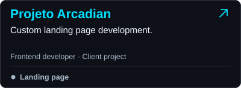</a>
  <a href="https://meulocal360.com.br/">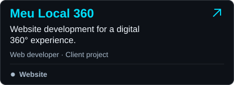</a>
  <a href="https://jvsprestadora.com.br/">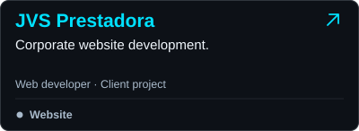</a>

---

## Tech stack

  
  
  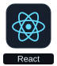
  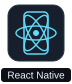
  
  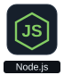
  
  
  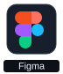

**Also working with:** Vite · Material UI · Expo · PostgreSQL · Git · Cloud infrastructure

---

From idea to production. Always building.

